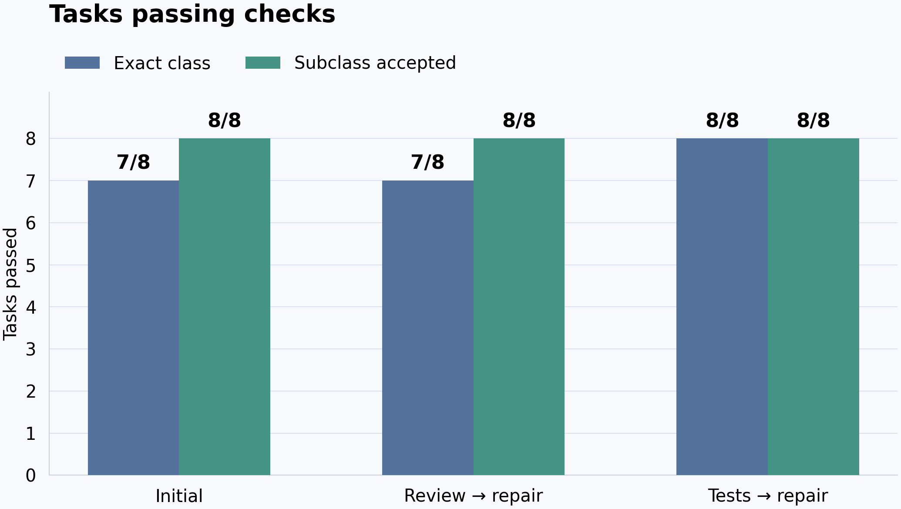

# AI code review versus independent tests

An eight-task paired synthetic pilot comparing a fresh AI code review followed
by repair with independently authored behavioral tests followed by repair.
**Completed pilot with a scoring artifact; no demonstrated winner.**

| Condition | Frozen exact-exception checker | Normal Python subclass handling |
|---|---:|---:|
| Initial patches (descriptive baseline) | 7/8 | 8/8 |
| AI review → repair | 7/8 | 8/8 |
| Independent tests → repair | 8/8 | 8/8 |

The entire difference is one path-validation task. Strict UTF-8 decoding raised
`UnicodeDecodeError`, a `ValueError` subclass. The frozen checker demanded the
exact class name `ValueError`, which the written contract did not require.
The test-guided repair wrapped the exception in a plain ValueError. Review kept
the original code. The other seven tasks passed both scorers.

An independent implementation using `unittest.assertRaises(ValueError)` scored
all 24 saved source snapshots: **8/8 in every condition**. The apparent one-task
gain is a grader artifact. This pilot reached a ceiling under contract-aligned
scoring and cannot establish the relative usefulness of either workflow.

The original checker, hashes, primary outcomes and raw incorrect/false-confidence
labels remain unchanged. Those raw labels describe exact-checker outcomes, not
demonstrated behavioral failures. See [RESULTS.md](RESULTS.md),
[oracle note](evidence/oracle-review-note.md) and the
[independent report](results/independent-recalculation.json).



Measured setup: gpt-6.1-sol/medium, INVARIANT 0.3.1, 8 authored tasks, 54 held-out
plus 8 public regression examples, and 230 generated examples, all qualified
against a frozen reference. There were 40 distinct native threads and 139 fully
reconciled provider responses. INVARIANT ran isolated native sessions and protected
PUBLIC checks; held-out evaluation ran separately in non-agent offline Docker.
Feedback-stage checks validate artifact format, not substantive review quality.

See [PROTOCOL.md](PROTOCOL.md) for conditions, blinding, matched settings,
oracle-assisted test qualification, outcomes and limitations. A green public
test is not the primary correctness outcome. Held-out checks remain outside
all model-visible workspaces, then are published for reproducibility.

## Requirements

Python 3.12+, a running Docker engine with the existing Python base image
pinned in lab/runtime.json for separate held-out evaluation,
INVARIANT 0.3.1 and its supported Codex CLI authenticated through an existing
subscription. No paid API, GPU rental, additional subscription or model download.
The actual account model is recorded in execution receipts, not guessed here.
Matplotlib is used only to render measured figures after completion.

## Commands

For a public clone, recalculate without inference:

```sh
python3 -m unittest discover -s tests -v
python3 verification/recalculate.py
python3 -m lab.audit
python3 -m lab.plot
```

The independent scorer needs the already-local image in lab/runtime.json, or
`--image YOUR_LOCAL_PYTHON_IMAGE` for another local Python 3.12 image with IANA
timezone data. It never pulls automatically and reports image identity.
**It intentionally exits 1 here** to report the documented scoring disagreement:
8/8/8 with subclasses versus 7/7/8 with exact types, in the same image, with
exactly two changed classifications (safe-path initial and review). This is
expected evidence, not a suppressed execution failure. Structural/hash audits
and unit tests pass. Details: [REPRODUCIBILITY.md](REPRODUCIBILITY.md).

The following were original preparation commands before a frozen run existed.
A published clone refuses to overwrite measurements; use a new namespace and
new freeze for a separately labelled new experiment.

```sh
python3 -m unittest discover -s tests -v
python3 -m lab.prepare
git add . && git commit -m 'Freeze paired verification protocol'
python3 -m lab.run --execute
python3 -m lab.report
```

`lab.prepare` freezes hashes and builds the initial case-scoped workspace.
`lab.run --execute` consumes subscription usage: a planned 40 fresh worker
sessions, potentially multiple model responses per session. It refuses to
overwrite previous measurements or replay uncertain attempts. INVARIANT executes
the native studies, isolated tools and protected public acceptance checks.
No candidate is automatically applied to this host repository.

`lab.report` reruns only deterministic Docker checks on saved candidate sources;
it performs no inference. Published sources, feedback and structured receipts
live in evidence/, derived outcomes in results/. Private .invariant/ state and
execution/ working copies are excluded from Git.

All tasks/examples/reference implementations were authored for this experiment
and licensed MIT. This is not a reproduction of ExecCritic or an assessment of
production review products. Eight small tasks cannot establish an industry-wide
winner, and the initial implementation may produce a ceiling result.

Tool: [INVARIANT](https://github.com/Xenox-developer/invariant).
Research context: [ExecCritic](https://arxiv.org/abs/2609.09133),
[Teaching Agents to Code Reliably](https://arxiv.org/abs/2610.03984).

## Resource accounting and limits

| Group | Sessions | Provider responses | Total tokens | Cached input subset |
|---|---:|---:|---:|---:|
| Initial | 8 | 33 | 307,194 | 184,704 |
| Review + repair | 16 | 54 | 507,428 | 298,624 |
| Tests + repair | 16 | 52 | 590,911 | 379,392 |

Total worker tokens: 1,405,533. Cached input is already included, not additional.
Measurement-stage wall time: 2150.8 seconds (35.8 minutes), including public checks
and reference qualification, excluding setup and later scoring/audit/plotting.
Outer-chat usage is unavailable. No dollar cost is inferred from subscription
tokens. Same per-session settings: 180 seconds, 2 CPUs, 2048 MiB; sequential models.
Artificial daily generation/overall-duration caps were removed before measurement;
zero-extra-spend restrictions remained.

Measured core commit: `15ab1282327b92ccd62750ea4fbd15de263b3dfa`.
[frozen.json](evidence/frozen.json) binds actual tasks/core/primary checker.
The setup-only failed JSON-mode init and pre-measurement compatibility correction
remain in history. No model attempt was consumed by that setup failure.

Contracts, references and literal expected examples were AI-authored before
measured sessions, with no external human benchmark validation. “Independent”
means candidate-blind test construction in fresh contexts, using the SAME model.
The initial baseline is not budget-matched to two-session verification/repair
treatments. Reference qualification is an extra oracle-assisted component and
did not catch the exception-interpretation error. Finite examples do not prove
correctness. See [METHODOLOGY_NOTES.md](METHODOLOGY_NOTES.md).

Evidence includes sources/feedback, qualification, validation receipts, candidate
hashes, concrete definitions, worker-input manifests, provider observations and
executor command witnesses. Private authentication/native-home state/mount paths
are excluded. Both repair arms began from byte-identical initial patches; all
40 contexts were distinct. Feedback authors did not modify their supplied source.
INVARIANT's clean source commit matched its public repository.

Exception hierarchy: [Python documentation](https://docs.python.org/3.12/library/exceptions.html#UnicodeError).
